# INHERIA

**People leave. Knowledge lives on.**

INHERIA helps a technical team transfer project knowledge and responsibilities when someone leaves or changes roles. It brings authorised documents and repository activity into one workspace, reconstructs source-linked knowledge, highlights uncertainty, supports human review and gives the incoming person a practical continuation plan.

**[Open the live product](https://inheria.onrender.com)** · **[Judge scenario guide](https://inheria.onrender.com/demo)** · **[Product documentation (PDF)](docs/INHERIA_Round3_Final_Product_Report.pdf)** · **[API documentation](API_CONTRACT.md)** · **[Verification evidence](docs/verification.md)**

The working journey is **Connect → Reconstruct → Verify → Review → Handover → Accept & Validate → Continue**. The implementation is a deployed web product with persisted accounts, project data, permissions, review history and responsibility transfer. The completed scope and remaining limits are described below.

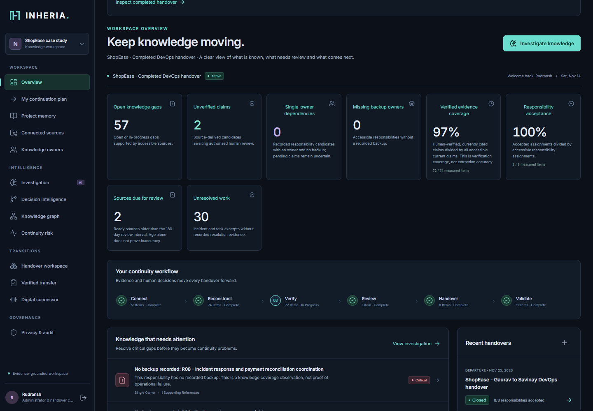

*Current live ShopEase judge workspace. Screenshots were captured on 14 November 2026 in an isolated public case-study workspace.*

[Judge access](#try-it-as-a-judge) · [Complete workflow](#how-the-complete-product-works) · [Features](#finished-capabilities) · [AI key setup](#optional-ai-bring-your-own-api-key) · [Local setup](#run-locally) · [Tests](#testing-and-reliability-evidence) · [Documentation and roadmap](#documentation-and-roadmap)

## Try it as a judge

Open **[inheria.onrender.com](https://inheria.onrender.com)** and choose an option beside sign-in:

| Entry | What you can test |
| --- | --- |
| **Open judge workspace** | Explore the completed ShopEase handover: 51 sources, 81 claim records, eight accepted responsibilities, eleven reviewed knowledge walkthroughs and an evidence-backed graph. |
| **Try a fresh handover** | Start with 13 sources and an unapproved transition; perform reconstruction, review, handover, acceptance and validation yourself. |
| **Explore demo** | Read the scenario and role guide before entering the workspace. |
| **Create an account** | Create your own organisation, project and authorised sources. |

**No email, password or API key is required for the core judge workflow.** Each visitor receives a separate, expiring workspace. The default visit lasts four hours. Role switching is limited to that visitor's three case-study identities and cannot access real accounts. Render Free can take about a minute to wake after inactivity; capacity and request-limit failures show a retryable message.

Free hosting has finite quotas, including Neon's 5 GB monthly database transfer budget. Idle workspaces do not continuously poll; active jobs use a small status signal and refresh results on completion. Exact citation checks run inside the database to reduce repeated document transfer. See [hosting limits and measurements](docs/deployment.md#database-transfer-budget). Optional AI usage requires your organisation's own provider key and may incur provider charges.

The ShopEase example uses authored demonstration material, not Wipro/client records. Completed-mode approvals are recorded case-study history; they are not actions performed by the visitor or evidence of independent operational assessment.

<details>
<summary>Screenshot: judge access beside sign-in</summary>

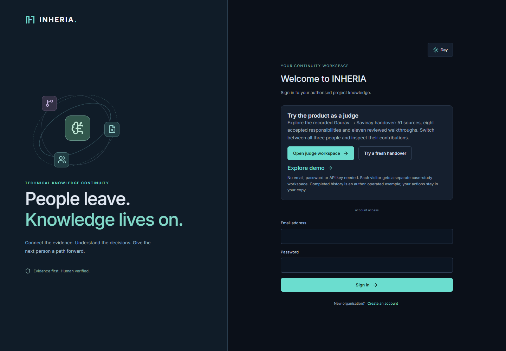

</details>

## What problem does it solve?

A departing DevOps engineer may know the deployment sequence, rollback restrictions, incident workarounds, backup ownership and reasons behind architecture decisions. Those details are often split across runbooks, repository history and personal experience. Giving a successor a folder of files leaves questions about relevance, freshness, permissions and ownership.

INHERIA turns those sources into reviewable knowledge. The successor can inspect the original evidence, see unresolved questions, accept responsibility and complete a supervisor-reviewed exercise. The coordinator can see which transfer steps are done and which prerequisites still block completion.

### ShopEase: Gaurav → Savinay, coordinated by Rudransh

ShopEase is a shopping-application DevOps case study. Its handover covers releases, deployment troubleshooting, infrastructure, monitoring, rollback, backup/recovery, access coordination and incident response.

| Person | Role | Main actions |
| --- | --- | --- |
| **Gaurav** | Departing DevOps engineer | Reviews responsibilities, supplies missing explanations and corrects project knowledge. |
| **Savinay** | Incoming DevOps engineer | Reviews the handover, requests missing knowledge access, accepts or rejects ownership and submits cited validation work. |
| **Rudransh** | Administrator/coordinator | Connects sources, manages membership, coordinates authorised review, assigns responsibilities and records closure after required checks pass. |

Real teammates use separate accounts in the same organisation and project. Source data is shared according to permissions; it does not need to be uploaded separately for each person. Technical assessments require an authorised, qualified reviewer.

Example: an old deployment guide disagrees with the current pipeline. INHERIA retains the supporting sources and flags the conflict for review. Gaurav supplies an explanation; another authorised reviewer verifies it. Savinay then reviews the approved procedure, accepts the release responsibility and submits a cited deployment walkthrough. If recovery evidence is missing or an exercise is rejected, the handover stays actionable through correction and revalidation.

## How the complete product works

| Step | Working behaviour | User-visible result |
| --- | --- | --- |
| **1. Connect** | Upload permitted PDF, DOCX, Markdown, TXT or JSON files; connect a public GitHub repository or an authorised private repository using an encrypted PAT. | Source inventory with status, version, timestamps, locators, access controls and sync history. |
| **2. Reconstruct** | Investigate connected evidence for project state, responsibilities, decisions, procedures, dependencies, incidents and unfinished tasks. | Source-linked candidate knowledge, project history, risk findings and targeted knowledge-capture questions. |
| **3. Verify** | Inspect exact quotations and document/page/line references; identify missing, stale, conflicting or uncertain information. | Explicit verification state and supporting evidence; generated assumptions are not confirmed responsibilities. |
| **4. Review** | An authorised reviewer approves, rejects or corrects claims. Employee explanations require another reviewer. | Reviewed knowledge, correction history and audit events; changes invalidate affected assessments. |
| **5. Handover** | Create the transition, generate the role-appropriate report, approve its current version and assign the incoming/backup owners. | Grouped knowledge, responsibilities, dependencies, open work and prerequisite checks. |
| **6. Accept & validate** | The successor accepts/rejects responsibility and submits cited scenario work. A separate authorised supervisor reviews criteria. | Traceable acceptance, assessment, revision and reapproval history. |
| **7. Continue** | Close when required gates pass; record current ownership and expose the successor's continuation view. | Responsibilities, approved procedures, open work, remaining questions and links to original evidence. |

Completion depends on **current approved evidence, incoming acceptance, supervisor-reviewed tasks and required readiness checks**. Required critical-gap follow-ups need relevant evidence, an accountable active project owner, a due date and a review note. Recording a follow-up keeps the underlying issue open; a completed knowledge transfer does not mean every production incident is solved.

Changed or revoked evidence can remove current readiness. Active handovers support reopening, correction, regeneration, reapproval and renewed acceptance/assessment. A previously closed ownership record is preserved; subsequent changes use a follow-up transition.

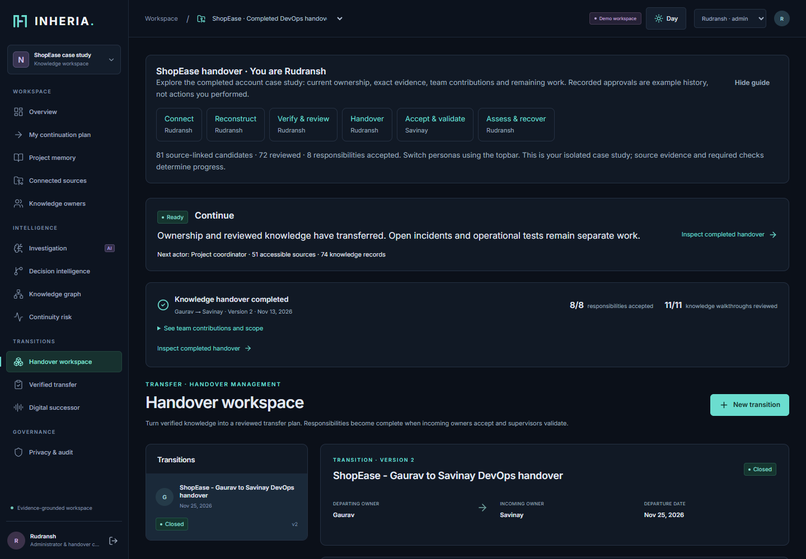

*Completion is recorded across the workspace, with ownership, version history and participant contributions.*

Before closure, the Handover page shows current acceptance, supervisor review,
evidence coverage and unresolved checks with links to the relevant work. Missing
or failed readiness disables **Close transition**; the backend checks again.
**Refresh readiness** and **Team → Refresh access** let users inspect teammate
updates. Temporary request limits show a cooldown and preserve saved work.

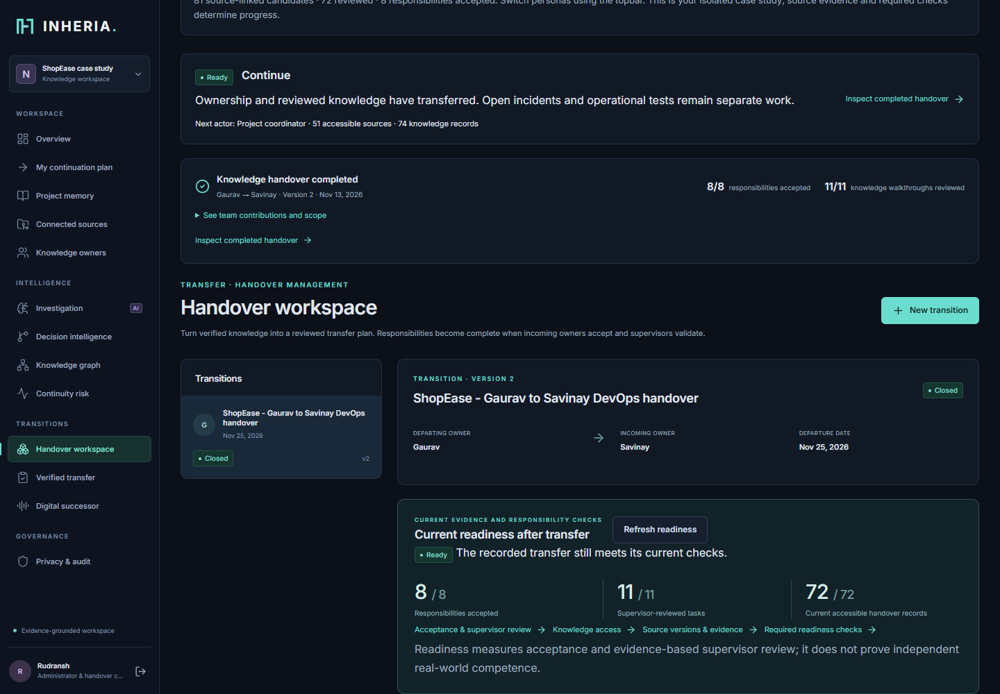

*Built local QA case study: accepted responsibilities, supervisor assessments and
current evidence are shown separately. This screenshot is not a production
execution record.*

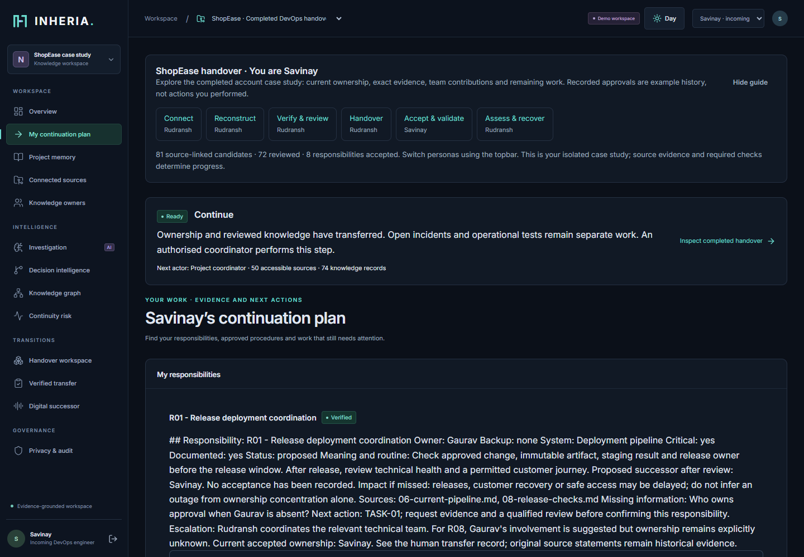

*The incoming person can find assigned responsibilities and approved procedures, then inspect their citations.*

## Finished capabilities

| Area | Delivered in the application |
| --- | --- |
| **Accounts and team access** | Organisation registration/login, projects, membership, expiring single-use invitation links, recipient-chosen passwords, authenticated existing-account joins, invitation/member revocation and audit history. |
| **Knowledge access readiness** | Current project/document permissions, missing handover-access checks, incoming access requests and separate authorised approval/rejection. Source ACLs remain enforced for administrators and derived knowledge. |
| **GitHub and document ingestion** | Functional REST/PAT connector, bounded repository metadata/history/files, incremental sync with ETags, retry/failure states, five document formats, locators and ACL-safe duplicate detection. |
| **Evidence-first intelligence** | Explicit English prose/structured extraction, project reconstruction, candidate responsibilities, decision rationale/alternatives, dependencies, unresolved work, ownership gaps, targeted text interviews and exact quotations. |
| **Relationship and risk views** | People/project/system/knowledge graph, cited relationships, cycle-safe dependency paths and hypothetical employee/dependency/procedure risk scenarios. |
| **Human knowledge review** | Approval, rejection, correction, conflicting-decision review, verification history, source freshness/version checks and separate review of employee testimony. |
| **Source-change investigation** | Document replacement, filtered downstream impact, historical versions, revocation/deletion, transitive evidence invalidation and resumable per-source investigation checkpoints. |
| **Handover management** | Departure date, generated reports, versioned approval, single-successor assignment, backup owner, incoming acceptance/rejection and auditable ownership after closure. |
| **Practical validation and recovery** | Deployment-review, rollback-readiness and recovery-evidence criteria; cited walkthroughs or external staging observations; separate supervisor review; rejected/reopened work and closure gates. |
| **Continuity experience** | Calculated next-step guidance, completed-transfer status, contribution history, successor continuation plan and explainable evidence/risk/readiness counts. |
| **Optional Digital Successor** | Private saved conversations, Low/High effort, provider-specific models, citations, labelled retrieval fallback and supported project actions with preview/confirmation. |
| **Governance and interface** | Tenant/project/source permissions, encrypted integration/provider keys, secret quarantine, selected PII redaction, filtered audit/privacy view, responsive navigation, day/night themes and reduced-motion support. |
| **Delivery infrastructure** | PostgreSQL deployment, SQLite local development, Alembic migrations, Docker, Render/Neon free hosting, automated CI and API/evaluation/browser test tooling. |

The long-term eleven-engine vision groups these domains; it does not mean every proposed enterprise feature is finished. See the [detailed feature/status matrix](docs/feature-status.md).

### Screenshots: evidence, dependencies and practical review

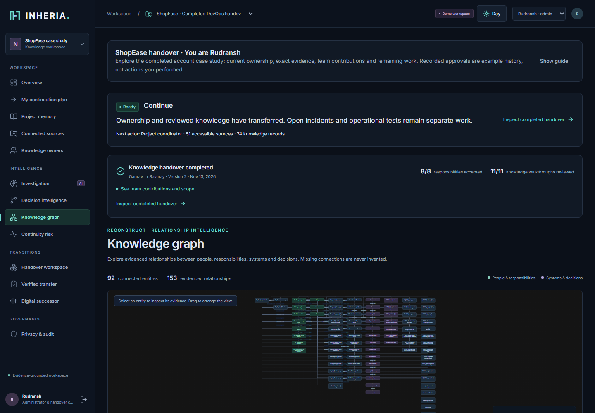

<details>
<summary>Connected sources, original evidence and supervisor validation</summary>

**Connected source inventory**

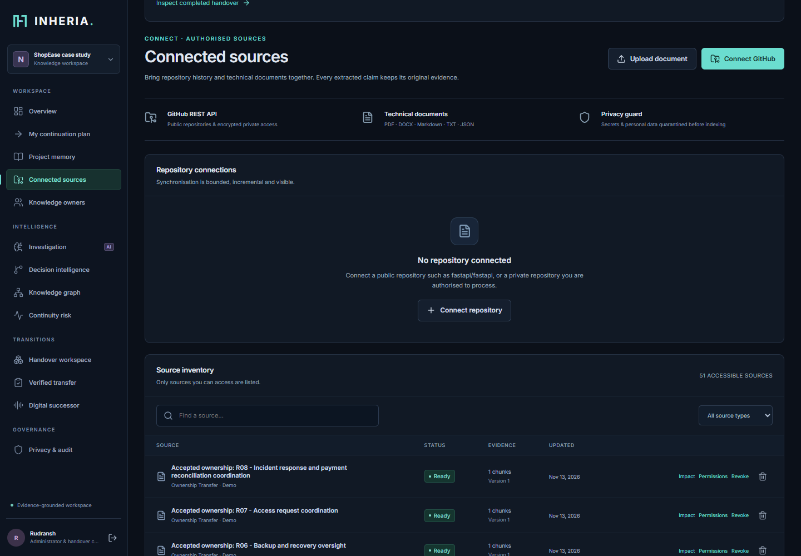

**Original source evidence**

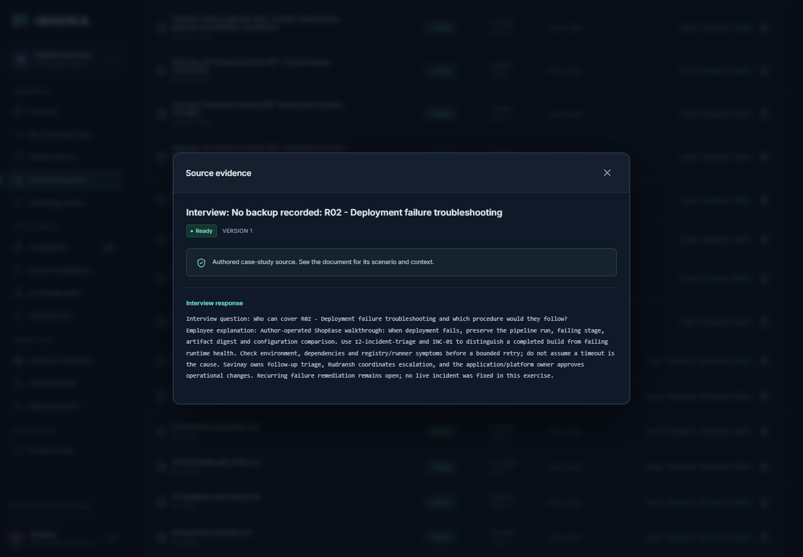

**Reviewed practical transfer**

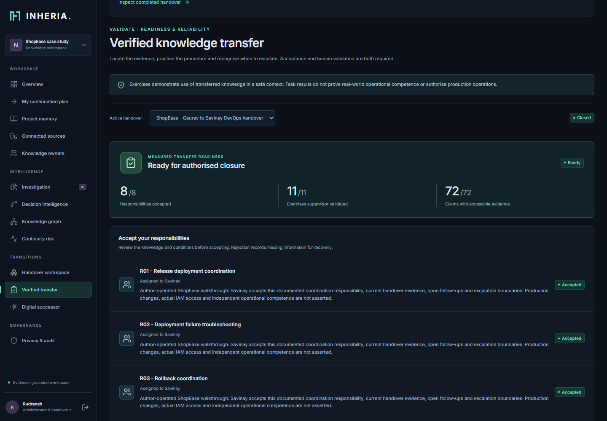

</details>

<details>
<summary>Day theme and mobile continuation view</summary>

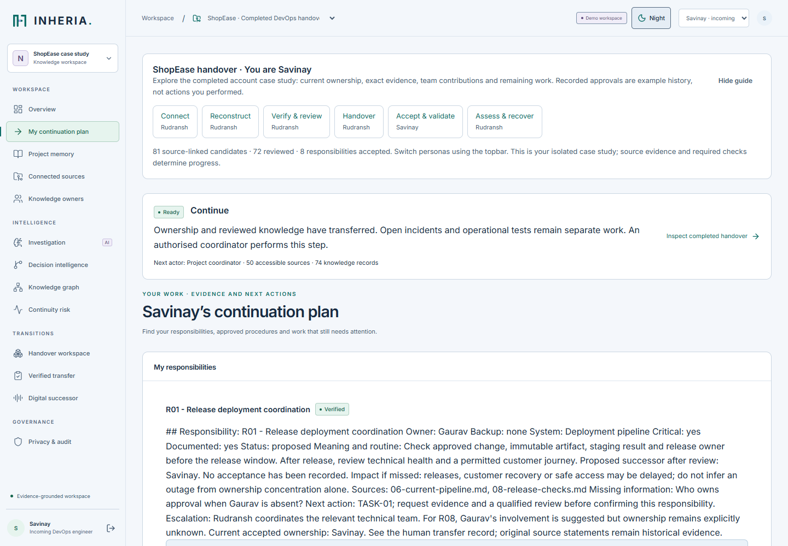

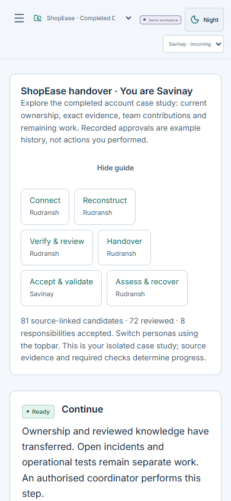

</details>

## Three submitted improvements: delivered scope

These are the **three commitments confirmed for the submission**. Conversational chat is additional functionality.

| Improvement | What changed for the user | Recorded acceptance evidence |
| --- | --- | --- |
| **1. Secure Team Onboarding & Access Readiness** | Incoming employees choose their password through a single-use expiring invite, request missing project/document access and see reviewer decisions. Administrators revoke invitations/membership with audit records. Ownership assignment is separate from knowledge access readiness. | Seven dedicated onboarding/access journeys; live invitation/source-permission checks; real PostgreSQL single-use and acceptance/revocation cases. |
| **2. Investigation & Source-Change Intelligence** | Supported prose reconstruction gains exact owner/rationale/dependency spans. Source replacement/removal exposes downstream impact and invalidates evidence. Interrupted investigations resume from committed source/version checkpoints without duplicate candidates. | 60-document initial internal holdout, ten distinct source-change/revocation scenarios, five interruption positions, actual worker restart/resume and a subsequent 72-document prose challenge. |
| **3. Practical Transfer Validation & Recovery** | Responsibility-specific deployment, rollback and recovery criteria, cited staging records, rejected/reopened transfer recovery, critical prerequisite gates and traceable reapproval. Successor submissions and supervisor assessments remain separate. | Twelve positive/negative role journeys, the complete browser handover and changed/revoked evidence tests. INHERIA executes no production commands. |

The dedicated three-improvement acceptance run passed **34/34 journeys**. Read the [exact promise-to-delivery map](docs/three-improvements-acceptance.md) and [test record](docs/three-improvements-tests.json) for denominators and limits.

## What was modified during finalisation?

| Change | Result |
| --- | --- |
| **Completed and fresh judge entries** | Judges can inspect a populated, sanitised account case study or perform a new unapproved handover directly from sign-in. Private credentials, provider settings and conversations are excluded. |
| **Continuation and closure guidance** | Each project calculates its next actor/action; typed recovery checks and owned critical-gap follow-ups make remaining work explicit. |
| **Permissions and stale evidence** | Membership/source changes recheck current authority; lost evidence prevents readiness and hides restricted derived content. UI approval rejects stale handover versions. |
| **Real PostgreSQL concurrency verification** | Fifteen cases check simultaneous writes and lock waits. An invitation revocation race was reproduced and fixed by serialising on the project row and reloading ORM state. |
| **Fresh prose extraction hardening** | Added explicit assigned/passive owners, reverse passive dependencies and more reason phrases; unconfirmed/historical statements remain uncertain and missing rationale stays missing. Original first-run failures are preserved. |
| **Judge-input and connector hardening** | Explicit managed/overseen duties, scoped component names, more causal wording, training-example rejection, visible partial-sync warnings, one queued job for concurrent Sync and mobile source-table containment. |
| **CI and public proof** | CI now supplies ephemeral PostgreSQL 17. Full-suite, extraction and live judge evidence are published with scope, hashes and limitations. |
| **Documentation and current screenshots** | This README now explains the complete journey, AI key setup, delivered commitments, reproducible checks and next development stages. |

Application fixes are in [`2d48c43`](https://github.com/Gauravwakle96/INHERIA/commit/2d48c435a2de431ac879d92c178cdaa7a03bd8fe); live/CI evidence was recorded in [`f5096a6`](https://github.com/Gauravwakle96/INHERIA/commit/f5096a6fbb2fe8469b6eeade50bb65f0855d2731). Earlier work and actual timestamps remain visible in [Git history](https://github.com/Gauravwakle96/INHERIA/commits/main).

### Changes from the original proposal

The broad eleven-engine vision was narrowed to the technical source-to-handover
journey and the three submitted improvements. Related intelligence shares models
and services instead of separate infrastructure for every engine. GitHub REST/PAT
is delivered; OAuth/webhooks and additional connectors remain declared future work.
Deterministic evidence extraction keeps the core workflow usable without paid AI;
optional models are provider-dependent. Practical validation records cited work
and human assessment instead of operating production infrastructure. Predictive
scores, cross-company learning and a general workflow builder were postponed to
prioritise evidence, permissions, review and transfer recovery.

## Optional AI: bring your own API key

**To use generated conversational AI answers, you must insert your own authorised provider API key.** The judge workspace does not inherit another account's key. The core source-to-handover workflow and labelled verified-evidence retrieval remain available without a key.

The implemented Agnes provider is **Bynara Router**:

| Setting | Value |
| --- | --- |
| Provider option | **Bynara · router.bynara.id** |
| Endpoint | `https://router.bynara.id/v1` |
| Model | `agnes-2.5-flash` |
| Protocol | **Chat Completions** |

1. Sign in as your organisation's **administrator**. In the isolated judge example, use Rudransh.
2. Open **Digital successor → AI settings**.
3. Select **Bynara · router.bynara.id**, `agnes-2.5-flash` and **Chat Completions**.
4. Enter your Bynara API key in **Provider API key**.
5. Enable **external AI processing for authorised users**, then **Save settings**.
6. Select **Test saved connection**. After a successful response, ask a question and choose **Low effort** or **High effort**.

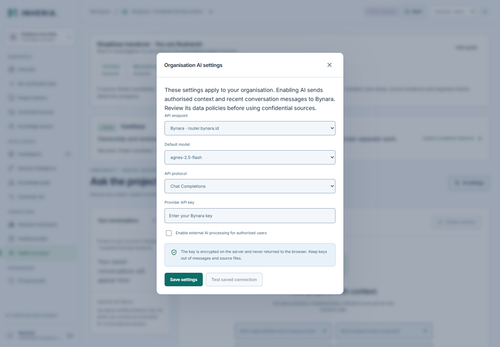

The server must have `INHERIA_TOKEN_ENCRYPTION_KEY` configured before it can store the key. Keys are encrypted on the backend and never returned to the browser. Keep them out of chat messages, uploaded documents and Git. Changing providers requires a new provider key. **AgentRouter** remains available for existing configurations and its configured GPT models; it is a separate service from Bynara.

Low/High changes context and output budgets. Replies retain inspectable citations; supported project actions show a preview and require confirmation. Slow upstream requests display a waiting state. Provider failure preserves the conversation and shows labelled evidence retrieval rather than inventing an answer. Only authorised context is eligible for external processing; provider fees and data policies are separate from free hosting.

One live Agnes reply returned two citations in 66.4 seconds. A broader historical 50-question run returned valid provider replies for 9/50 primary questions, so universal availability or conversational accuracy is not established. See [chat setup](docs/chat-integration-plan.md), [individual live result](docs/bynara-live-verification.json) and [evaluation/failure record](docs/four-workstream-acceptance.md).

## Architecture and technical decisions

INHERIA is a modular monolith: one REST backend serves the built web frontend and applies shared permission/evidence rules. Durable state lives in PostgreSQL; frontend state is refreshed after mutations and role changes.

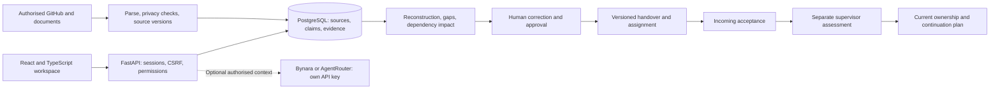

| Layer | Technology and purpose |
| --- | --- |
| Frontend | React, TypeScript, Vite, React Router, TanStack Query, React Flow and shared semantic CSS tokens. Self-hosted Inter font; day/night and reduced motion. |
| Backend | Python, FastAPI, Pydantic validation and modular ingestion/intelligence/onboarding/transfer services. |
| Persistence | SQLAlchemy, PostgreSQL/psycopg in production, SQLite for development, Alembic schema migrations and indexed tenant/project relationships. |
| Source processing | GitHub REST via HTTPX; PyMuPDF for PDF; python-docx; UTF-8 text/JSON parsers. |
| Security | Argon2 passwords, hashed opaque sessions/invitation tokens, HttpOnly cookies, CSRF/origin checks, source ACLs, Fernet-encrypted integration/provider tokens. |
| Intelligence | Bounded deterministic extraction and lexical evidence retrieval; optional validated structured model extraction; organisation-configured conversational provider. |
| Jobs | Persisted sync/investigation status, bounded background tasks and atomic per-source checkpoints. |
| Deployment and QA | Docker, Render Free, Neon PostgreSQL, GitHub Actions, pytest/coverage/Ruff/pip-audit and Playwright/axe. |

The schema covers organisations, users, memberships, sources/chunks, claims/evidence, decisions/dependencies represented through knowledge records, gaps, investigations, transitions/transfers, exercises, jobs, audits, invitations/access requests and private AI conversations/settings. Claims retain their source references and verification state.

A separate vector store, graph database and distributed worker were omitted for this bounded workflow. Those services would add operating complexity without resolving the central handover requirement. See [architecture and trust boundaries](docs/architecture.md) and [API contract](API_CONTRACT.md).

### Repository structure

```text
backend/app/          API, permissions, ingestion, intelligence and transfer services
backend/migrations/  Versioned Alembic database migrations
backend/tests/        API, permission, lifecycle and PostgreSQL transaction tests
backend/evaluation/   Labelled corpora and reproducible evaluation runners
frontend/src/        Workspace pages, shared UI, themes and API client
frontend/tests/      Playwright journey, failure and accessibility checks
docs/                Architecture, delivery, verification, setup and roadmap
docs/screenshots/    Current live product screenshots and capture record
.github/workflows/   Backend and frontend verification CI
Dockerfile           Combined frontend/API production image
compose.yaml         PostgreSQL-backed Docker setup
render.yaml          Free-hosting service definition
```

## Run locally

Use a normal project directory. The documented development setup uses **Python 3.13**, **uv**, **Node 24**, **npm** and a current browser. Python package metadata supports 3.12 or newer; the dependency lock files define installed versions.

```powershell
git clone https://github.com/Gauravwakle96/INHERIA.git
cd INHERIA
```

Start the API:

```powershell
cd backend
uv sync --frozen
Copy-Item .env.example .env
uv run alembic upgrade head
uv run uvicorn app.main:app --host 127.0.0.1 --port 8010
```

For an existing checkout, preserve your `.env` instead of copying over it. The default local settings use SQLite, a labelled Nexora development scenario and a separate ShopEase judge walkthrough. Nexora contains five fictional employees, three repository fixtures, 75 commits, 12 pull requests, 25 issues and ten documents; its authored activity is not attributed to real GitHub contributors. You can also register a new organisation.

In a second terminal, from the repository root:

```powershell
cd frontend
npm ci
npm run dev -- --host 127.0.0.1 --port 5173
```

Open **http://127.0.0.1:5173**. Interactive backend docs are at **http://127.0.0.1:8010/docs**. API mutations require the session cookie and the `X-CSRF-Token` returned by sign-in or `/api/auth/me`. The frontend development server proxies `/api` to the backend.

To use your own sources: create an organisation/project, invite members from **Knowledge owners**, upload permitted documents under **Connected sources**, then follow the next-step panel. Public GitHub repositories can be connected without a PAT; private access requires an authorised least-privilege token and server encryption configuration.

### Environment variables

See [backend/.env.example](backend/.env.example) and the [deployment configuration](docs/deployment.md). Secret `.env` files are ignored.

| Variable | Purpose |
| --- | --- |
| `INHERIA_DATABASE_URL` | SQLite development URL or PostgreSQL/psycopg URL with TLS for deployment. |
| `INHERIA_ENVIRONMENT` | `development` or `production`. Production requires PostgreSQL and HTTPS origins. |
| `INHERIA_DEMO_MODE` | Shared Nexora development persona access; must be `false` in production. |
| `INHERIA_ALLOWED_ORIGINS` | JSON array of exact permitted origins for writes. Render can supply its HTTPS origin automatically. |
| `INHERIA_TOKEN_ENCRYPTION_KEY` | Stable Fernet key for private GitHub and organisation AI credentials; never commit it. |
| `INHERIA_JUDGE_DEMO_ENABLED` | Enables visitor-isolated judge workspaces independently of development persona login. |
| `INHERIA_JUDGE_DEMO_HOURS` / `INHERIA_JUDGE_DEMO_MAX_VISITS` | Visitor expiry and capacity; defaults four hours and forty visits. |
| `INHERIA_LLM_ENABLED` | Explicit opt-in for the optional server-configured structured extraction provider; disabled by default. |
| `INHERIA_LLM_BASE_URL` / `INHERIA_LLM_API_KEY` / `INHERIA_LLM_MODEL` | Optional backend extraction-provider configuration; separate from organisation chat settings saved in the UI. |
| `INHERIA_TEST_POSTGRES_URL` | Test-only loopback PostgreSQL URL with database name ending `_qa`; enables the concurrency tests. |

The application does not read Codex's credentials or configuration. Organisation chat is configured through **AI settings**; do not place its API key in frontend environment variables.

## Testing and reliability evidence

Latest full backend verification: **239 tests passed**, including **17 real PostgreSQL cases**. The previous coverage run measured **89% line coverage**; the latest run is not a new coverage measurement. [CI run 43612540914](https://github.com/Gauravwakle96/INHERIA/actions/runs/43612540914) passed backend lint/format/tests/dependency audit and frontend lint/typecheck/build/npm audit for the deployed judge-input changes. The exact submitted three-improvement runner also passed **34/34** again on 14 November. Latest judge-input verification is recorded below and in the [hardening evidence](docs/judge-input-hardening.md).

| Test area | Executed evidence |
| --- | --- |
| Main workflow | Source ingestion, candidate reconstruction, exact-citation inspection, review, handover approval, incoming acceptance, scenario assessment, recovery gates and closure. |
| Permissions | Tenant/visitor isolation, project/source ACLs, restricted evidence denial, missing access, member/source revocation and derived-history filtering. |
| Real database concurrency | Separate PostgreSQL sessions and actual lock waits for duplicate acceptance/assignment/closure/approvals, JSON edits, source/access changes and invitation races. |
| Failure/recovery | Invalid inputs/files, quarantine, conflicting/missing/stale evidence, connector errors/retries, rejected/reopened tasks, interruption/checkpoint resume and process restart. |
| Live product | New prose upload → four pending exact-cited candidates → review → generated handover; completed/fresh judge entry, refresh, 51 sources/81 claims/92 graph nodes and successor continuation. |
| Browser/accessibility | Representative 390/768/1440px checks, day/night themes, keyboard/reduced-motion checks and zero automated axe A/AA findings in the recorded bounded runs. |
| Final judge recovery checks | Eight focused browser checks passed for premature closure, changed/unavailable evidence, 429 cooldown, exact-three guide, team/source permission refresh and successful/failed background completion. The complete local fresh-to-closed UI journey passed separately in 3.4 minutes. |

**Extraction measurements:** the original 60-document internal first run (34 prose cases) met its submitted thresholds. A subsequent 72-document all-prose first run exposed real misses: precision 94.6%, recall 88.3%, owner fields 84.6%, rationale 75.0% and dependency endpoints 83.3%. After general fixes, its now-known regression cases measure precision 100%, recall 98.3%, owners 92.3%, rationale 100% and dependencies 94.4%. The unchanged original report remains published. These are internally authored labels and tuned regression results, not independently measured enterprise accuracy.

**Further judge-input checks:** a new 72-case first run exposed owner, rationale,
dependency and training-example failures; its original report remains published.
After general fixes, a separate frozen 60-document first run met targets:
precision 100%, recall 96.2%, owners 95%, rationales 91.7% and dependencies 100%.
Two misses remain. Labels are internal and implementation-informed. The own public
repository also completed a live authenticated 40-source import and incremental
resync with zero new imports. See [judge-input and GitHub evidence](docs/judge-input-hardening.md).

No independent five-person usability verification is claimed. Automated checks establish the recorded behaviour; human operational competence and source authenticity still require qualified review.

From `backend`:

```powershell
uv run ruff check app tests
uv run ruff format --check app tests
uv run pytest -q --cov=app
uv run pytest -q tests/test_acceptance_evaluation.py
uv run pip-audit --local
```

Without `INHERIA_TEST_POSTGRES_URL`, the PostgreSQL tests **skip explicitly**. To run them, set it privately in your shell to an owned loopback PostgreSQL database whose name ends in `_qa`, then run:

```powershell
uv run pytest -q tests/test_postgres_concurrency.py tests/test_transfer_budget.py
```

The fixture creates and removes only a unique QA schema. It rejects remote hosts and database names outside the test convention. GitHub CI supplies an ephemeral PostgreSQL 17 service. See [reproduction and original race failure](docs/postgres-and-extraction-hardening.md).

From `frontend`:

```powershell
npm run lint
npm run typecheck
npm run build
npm audit
npm run test:e2e
```

Browser tests require the local frontend/API, installed Google Chrome and an isolated demo database; they mutate their test workflows. See [frontend test setup](frontend/docs/frontend.md), [verification history](docs/verification.md), [transaction report](docs/postgres-concurrency-verification.json) and [live results](docs/postgres-extraction-live-verification.json).

## Privacy, security, accessibility and responsible design

- **Permission-aware:** backend organisation/project/source checks apply to documents, claims, graph relationships, handovers, saved answers and derived evidence. A source connection alone does not authorise unrestricted disclosure.
- **Traceable:** important knowledge retains exact quotations, source identity/version and human verification state. Missing information stays missing; hypothetical risk is labelled.
- **Controlled sharing:** invitation/access decisions and revocations are audited. INHERIA knowledge access does not grant AWS, IAM or other external-system permissions.
- **Secret handling:** private tokens/provider keys are encrypted server-side; sessions are opaque HttpOnly cookies. Document size/format checks, probable-secret quarantine and selected PII redaction run before indexing.
- **Human oversight:** successors accept their own responsibilities; another authorised reviewer assesses practical work. Previewed chat actions require confirmation. No production/cloud command is executed by INHERIA.
- **Accessible interface:** semantic labels, visible focus, native dialogs/forms, responsive navigation, day/night themes and reduced-motion support. Automated axe checks are bounded; a full assistive-technology audit remains future work.

Encryption at rest, backups, provider contracts and wider compliance need deployment-specific controls. Pattern-based privacy checks can miss sensitive information. See [trust-boundary architecture](docs/architecture.md) and [responsible-design explanation](docs/round3-delivery.md).

## Known limits and unfinished scope

| Limit | Current behaviour / next work |
| --- | --- |
| Arbitrary or multilingual prose | English patterns have measured limits. Pronoun-only ownership and uncertain shared attribution can remain unresolved; independent labels and broader semantic evaluation are needed. |
| GitHub completeness and other connectors | REST/PAT snapshots are bounded and marked partial. OAuth/webhooks and Jira/Slack/Teams/Confluence/GitLab/Drive/ServiceNow adapters are not implemented. |
| Scanned/encrypted documents | PDF text extraction works; integrated OCR is absent. Encrypted PDFs must be unlocked before ingestion. |
| Enterprise identity | No invitation email delivery, verified-email flow, password reset, SSO or MFA. Invitation links are privately shared. |
| External permissions/operations | Source-system permission mirroring and cloud access grants are absent. Staging observations must come from authorised external records. |
| Operational scale | Jobs/rate limits are bounded in process. Restart/resume is tested; distributed queues, shared rate limiting and load benchmarks remain work. |
| Handover scope | One incoming participant per transition. Practical submissions establish reviewed knowledge transfer, not guaranteed engineering competence. |
| Governance | Automated retention, legal hold, data residency and enterprise compliance are not implemented. |
| AI availability | Your own key and provider access are required for generated chat. Upstream outages/limits can trigger labelled retrieval fallback. |
| Hosting | Free-tier cold starts, quotas and visitor capacity can affect availability. |

Cross-company learning, predictive scores, multi-person departure simulations, a general workflow builder and advanced historical restoration remain outside the completed MVP. Full status is in [feature-status.md](docs/feature-status.md).

## Documentation and roadmap

| Document | What it contains |
| --- | --- |
| [Architecture](docs/architecture.md) | Data flow, schema, trust boundaries, storage and technical decisions. |
| [API contract](API_CONTRACT.md) / [OpenAPI snapshot](docs/openapi.json) | Routes, request/response behaviour and API access requirements. |
| [Deployment](docs/deployment.md) | Render/Neon free setup, secret configuration, migrations, health checks and hosting limits. |
| [Operating guide](docs/operating-guide.md) | Responsible actors, expected failures, recovery, migrations, rollback and release maintenance. |
| [Judge guide](docs/judge-guide.md) | Scenario, role actions and the source-to-validation journey. |
| [Feature status](docs/feature-status.md) | Implemented, partial, postponed and unimplemented capabilities. |
| [Three-improvement acceptance](docs/three-improvements-acceptance.md) | Submitted promises, delivered behaviour, measurable acceptance and scope limits. |
| [Verification](docs/verification.md) | Dated tests, failures, fixes, browser checks, audits and live evidence. |
| [PostgreSQL/extraction hardening](docs/postgres-and-extraction-hardening.md) | Real concurrency checks, invitation bug, fresh prose results and reproduction. |
| [Connectors and datasets](docs/connectors-and-datasets.md) | Actual adapters, limits, licences, public-repository research and dataset status. |
| [Chat configuration](docs/chat-integration-plan.md) | Provider settings, key isolation, citations/actions and fallback boundaries. |
| [Completion behaviour](docs/completion-hardening.md) | Case-study copying, continuation, readiness categories and source-change recovery. |
| [Delivery/submission mapping](docs/round3-delivery.md) | Product/rubric mapping, responsible design and actual-history disclosure. |
| [Final product acceptance](docs/final-product-readiness.md) | Judge journey, exact three improvements, rubric evidence and remaining submission items. |
| [Judge-input hardening](docs/judge-input-hardening.md) | Preserved first-run misses, separate holdout, real GitHub sync, duplicate-request and mobile fixes. |
| [Unaided usability tasks](docs/usability-task-pack.md) | Ready-to-use tasks and actual-observation template; no user-study result is assumed. |
| [Future roadmap](docs/roadmap.md) | Four prioritised milestones, estimated effort, dependencies, risks, delivery artefacts and measurable release gates. |

Future priorities are **independently evaluated extraction**, **verified team identity and permission lifecycle**, then **durable jobs and operational governance**. Each stage has measurable exit criteria in the roadmap; planned work is not counted as a finished feature.

## Deployment and licensing

The live deployment uses one **Render Free Docker web service** and **Neon PostgreSQL**, sharing one HTTPS origin for frontend/API. The [Dockerfile](Dockerfile), [compose.yaml](compose.yaml) and [render.yaml](render.yaml) describe the deployment. Docker Compose supplies local PostgreSQL; configure the root [.env.example](.env.example), credentials and an HTTPS origin before using production mode.

Production disables shared development persona login. Visitor-isolated judge access is configured separately. Application data lives in PostgreSQL rather than the ephemeral Render filesystem. The operator must configure backups, monitoring, encryption and capacity for a real deployment. Provider API usage is not included in free hosting.

**PyMuPDF/MuPDF is AGPL/commercial.** Meet its licence obligations or obtain a suitable Artifex commercial licence before proprietary distribution. Inter is self-hosted under SIL OFL. Third-party libraries, repository content and datasets retain their own licences and access conditions; see [licensing/source notes](docs/connectors-and-datasets.md).

INHERIA completes the selected technical knowledge-transfer workflow. The repository documents what is demonstrable today, the evidence behind it and the remaining work for broader organisational use.
