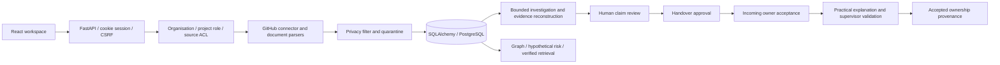

# Architecture and trust boundaries

INHERIA is a modular monolith. The UI communicates only with REST endpoints under `/api`. Frontend request state is managed by React Query; the Vite development server proxies API calls to FastAPI. The production build is served by the same FastAPI process.

## Data model

Twenty-five persisted tables cover organisations, users, project memberships, sessions, projects, connections, sources, versioned chunks, claims, evidence, investigations, gaps, simulations, transitions, transfers, exercises, jobs, audit records, AI configurations, conversations, chat turns, action previews, demo visits, invitations and access requests. IDs are UUIDs. Tenant and project foreign keys, uniqueness constraints and indexes constrain duplicates and support permission-scoped queries. JSON fields contain typed service payloads; source text and quotations are explicit records, not arbitrary AI assertions.

## Judge and onboarding boundaries

Public demo start creates a separate tenant, three random-password personas, 13 authored documents and a planned transition. A hashed expiring visitor capability scopes switching to that visitor's identities. Real accounts cannot be impersonated. Shared development persona login remains disabled in production. Expired visits are refused immediately and deleted on the next demo start; this is not a scheduled retention service. The default cap is forty concurrent visits; admission is not a distributed reservation.

Invitations use hashed random tokens, expiry and transactional single-use consumption. New recipients choose passwords; existing identities authenticate and retain their role. Links are shown once for private sharing. No email delivery, email verification, password reset or SSO is claimed. Independent access reviewers use existing source ACLs; they grant no cloud access and do not mirror upstream permissions.

Administrators may revoke project membership with a confirmation and reason. Pending invitations/access requests and explicit reader grants are revoked in the same transaction; other projects and historical contributions remain. If the removed member was a source's last reader, that source is revoked rather than converting its empty ACL into access for all. PostgreSQL project locks serialize membership removal with invitation acceptance. Handover knowledge-access readiness checks current membership and verified readable claims; it is separate from responsibility acceptance and operational competence.

## Investigation and recovery

Reconstruction candidates and each source-version checkpoint commit atomically. Resume rechecks authority, skips unchanged checkpoints and deduplicates fingerprints. Conservative English prose extraction preserves exact supporting field spans. Same-topic conflicting decisions require explicit authority selection and independent review.

Document replacement preserves old chunks and invalidates derived claims and assessments. Filtered impact traces affected handovers and tasks. Active transitions reopen for a new version, reapproval, reacceptance and scenario assessment. Superseded tasks remain historical and are excluded from corrected-version readiness. Mandatory cited prerequisites and current source/claim signatures gate closure. Historical quotes and inaccessible prerequisite notes are withheld from current read paths.

Validation distinguishes a cited knowledge walkthrough from an externally supplied staging observation. Observation references must be verified, current, readable and explicitly describe a staging/test-environment observation or result; a runbook alone is refused. Observation source versions and separate supervisor review history are retained. Change, revocation, deletion or lost access blocks readiness/review and hides unreadable submissions. These checks do not prove an external deployment or restore occurred.

Immutable Alembic migrations create and evolve the schema. Development startup supports automatic creation; production relies on migrations. SQLite is a local convenience. PostgreSQL is required by production configuration. pgvector, Redis, Celery and a separate graph database were omitted because bounded lexical retrieval and local jobs meet the central workflow without extra infrastructure.

## Evidence lifecycle

The chat migration adds four tables: encrypted organisation AI configurations, owner-scoped conversations, idempotent turns and expiring action previews. Provider requests snapshot configuration, release their database connection and recheck current authority/evidence afterward. History retains cumulative claim/source version signatures and role signatures; invalidated history is withheld and deleted-source text is purged. Generated output is never published as verified knowledge. See [chat design](chat-integration-plan.md).

## Source evidence lifecycle

Sources retain names, locators, timestamps, checksums, versions and ACLs. Chunks include their source version. Every candidate has exact quotation evidence. The active read path verifies tenant/project, source access, ready status, source/chunk identity, version and quotation membership. A mixed-permission claim is hidden entirely. Transaction-scoped evidence batching is cleared after flush, commit or rollback.

Derived interview and ownership sources retain parent evidence IDs. Source authorization checks their complete parent chain, including current readiness and reader ACLs; absent parents and cycles deny access. The inventory loads one project-scoped source map to avoid membership queries per source. Source changes invalidate transitive derived claims/tasks; impact and deletion traverse the same parent relationships. Migration `b19e47a2c805` backfills historical interview lineage from same-project gaps without changing ACLs or document content. Its isolated populated upgrade/downgrade test verifies existing metadata and grants are preserved; no production downgrade is performed.

Source changes invalidate derived claims. Revocation immediately removes authoritative access. Deletion removes indexed chunks, evidence and source-derived text from claims and stored investigation/simulation/handover/validation snapshots. Historical data is never returned as current evidence after version changes. Corrections return to pending, retain audit metadata and invalidate dependent practical assessments.

## Authentication and authority

Argon2 hashes passwords. Random session tokens are stored only as SHA-256 digests; HttpOnly SameSite=Strict cookies hold the opaque token. Authenticated mutations require a separate session CSRF header, permitted Origin and same-site request context. Organisation privilege and project membership privilege must both permit supervisor writes. Source ACLs apply even to administrators.

Demo persona sign-in is explicitly gated and rejected in production. New organisations can create project team accounts as administrators. Enterprise SSO/MFA, invitation mail, password resets, federated roles and source OAuth are documented unimplemented capabilities.

Claims, handovers, acceptance and practical validation have distinct states. Assignment is limited to the single transition participant whose readiness will be assessed. Closure requires all departing-employee responsibilities, current approved evidence, incoming acceptance and supervisor-reviewed exercises. It creates an auditable human ownership record and updates the current owner; prior source statements remain available as historical evidence.

## Expensive and external work

GitHub synchronisation and investigations use persisted status records with bounded in-process background work and separate sessions. Restarts label incomplete jobs as interrupted. This is observable local processing, not a durable distributed scheduler. API and sign-in limits are bounded in process; multi-worker deployments need a shared rate limiter and durable job worker.

GitHub uses a fixed HTTPS API host, bounded pagination, ETags, retries and incremental cursors, without repository cloning. Tokens are encrypted with a configured key, never sent to the browser or logs. Partial snapshots do not falsely advance a complete-sync cursor. No future connector is represented as connected.

LLM source processing requires explicit configuration and opt-in. A single investigation uses at most 15 chunks / 30,000 input characters and structured candidates. Exact citation validation rejects invented text or restricted chunk IDs. Requests use `store=false` and do not send previous response IDs or conversation references. Provider retention and contractual controls still need operator verification.

Chat evidence carries source timestamps, verification state and review-required age signals; accessible decision conflicts are supplied as uncertainty rather than verified facts. Low/High settings control context/output budgets. HTTP-200 upstream error envelopes are treated as safe provider failures and conversation history persists with labelled evidence retrieval. The 50-question live evaluation measured substantial Bynara outages; semantic citation quality is not established beyond the small successful subset. See [measured acceptance](four-workstream-acceptance.md).

## Metrics and simulations

Metrics expose numerator, denominator and formula descriptions; missing denominators return null. Verification coverage measures reviewed current claims, not extraction accuracy. Source age is a review trigger, not proof of decay. Simulations distinguish employee unavailability, dependency failure and unverified/stale procedures; assumptions and hypothetical effects are separate from source evidence. No precise financial impact or competence guarantee is inferred.
